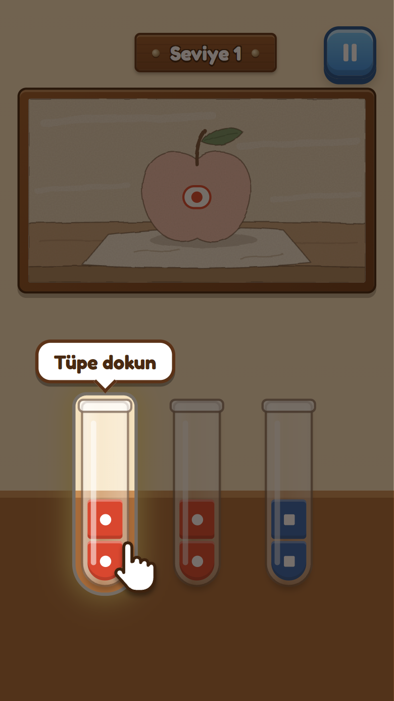
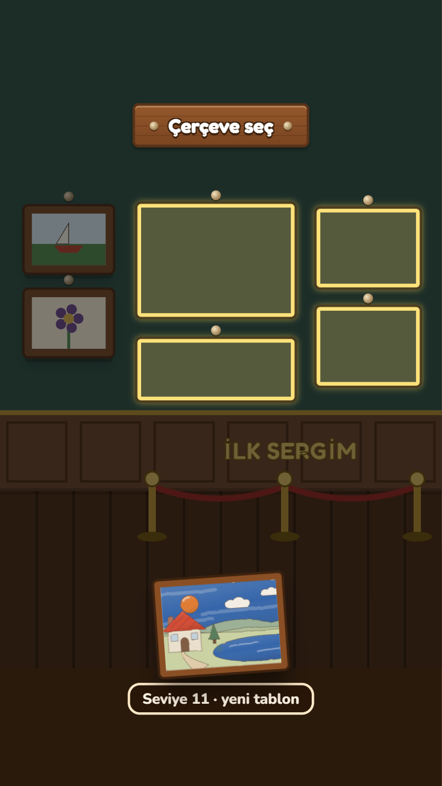
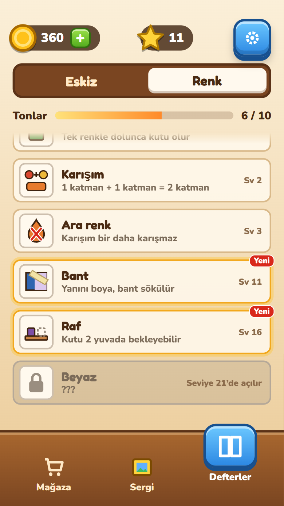
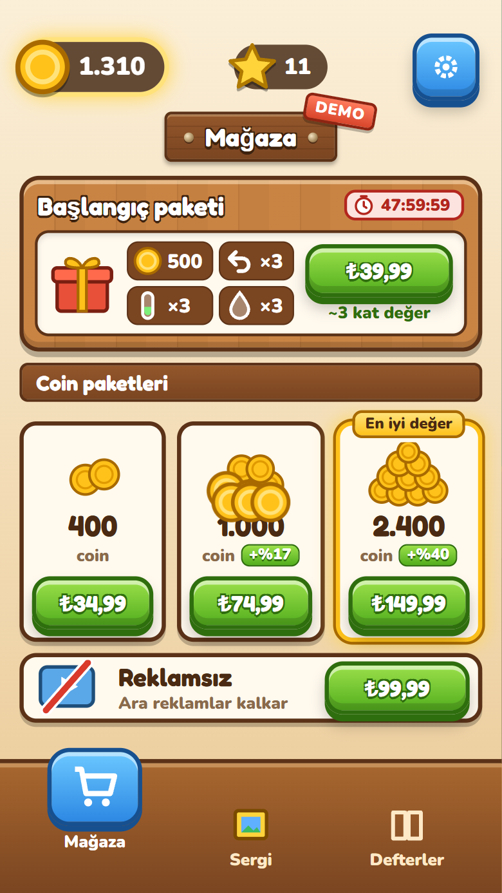

# Drip Gallery

A mobile-first color-sort puzzle where every solved board paints a picture.
Pour paint between tubes, mix colors, and fill the regions of a painting to hang it in your gallery.

**▶ Play in the browser:** https://drip-gallery.vercel.app
(Works on phones too: add it to your home screen and it runs offline.)

Designed and built by **Sezai Göçmen** as a game UX/UI portfolio project — from competitor research and GDD through
wireframes, art direction, level design, sound and a playable web build.

| Tutorial | Gallery | Rules notebook | Shop (demo) |
|---|---|---|---|
|  |  |  |  |

The game text is in Turkish.

## The game

- **Core loop:** select a tube, pour onto a matching color. When a tube holds one color, it paints its region of the painting.
- **30 hand-tuned levels**, each with its own gouache-style painting, introducing one mechanic at a time:
  mixing (red + yellow → orange; a mixed color can't be mixed again), **tape** (paint the neighbor to peel it off), the **shelf** and, from level 21, **white**.
- **Boosters:** Undo, extra Tube, Turpentine.
- **Meta:** a gallery wall to frame finished paintings, a rules notebook that records each mechanic as it is learned, a demo shop.
- **Feel:** pour and mix animations, particle effects, sound effects, music ducking, haptics,
  and a working "reduce motion" setting.
- **Saves progress** locally and is an installable **PWA** (network-first service worker, offline after first visit).

## Tech

- Plain JavaScript ES modules, HTML and CSS. **No framework, no build step, no dependencies.**
- All art (tubes, paintings, icons, scenes) is drawn in code (`js/cizim/`), so the whole game is about 2.7 MB.
- Game rules live in one pure module (`js/motor/kurallar.js`) shared by the game, the level solver and the tests.

```
index.html, sw.js, manifest.webmanifest
css/             layout, game and screen styles
js/main.js       entry point
js/akis.js       game flow (input, pours, win/lose, rewards)
js/motor/        rules engine
js/cizim/        procedural drawing: tubes, paintings, icons, particles
js/ekranlar/     screens: tutorial, gallery, notebooks, shop, settings, level end
js/veri/         data: colors, levels, paintings, sound list
araclar/         tools: level solver, level generator, dev server, icon generator
test/            automated tests
```

### Level design tools

- `araclar/cozucu.mjs` — a breadth-first **solver** that finds the shortest solution of a board and measures how many
  moves are "fatal" (turn a solvable board unsolvable). A compressed copy of the rules is cross-checked against the real
  rules engine with thousands of random moves.
- `araclar/seviye-uret.mjs` + `seviye-plani.mjs` — generate candidate boards and keep the ones that hit the
  **difficulty curve** planned per level (tubes, colors, move budget, fatal-move rate).

## Run locally

Requires [Node.js](https://nodejs.org) 18+.

```
node araclar/sunucu.mjs 5173
```

Then open http://localhost:5173.

## Tests

```
node test/kural-test.mjs    # rules: 17 checks
node test/cozucu-test.mjs   # solver vs. real rules engine
node test/seviye-test.mjs   # every level is solved within its move budget: 328 checks
node test/akis-test.mjs     # plays the game in headless Chrome with real taps: 27 checks
```

`akis-test` needs Google Chrome installed and writes screenshots to `test/cikti/`.

## Glossary (Turkish file and code names)

| Turkish | English | | Turkish | English |
|---|---|---|---|---|
| akış | flow | | seviye | level |
| araçlar | tools | | tablo | painting |
| çizim | drawing | | tüp | tube |
| çözücü | solver | | renk | color |
| ekranlar | screens | | karışım | mix |
| kayıt | save | | bant | tape |
| kurallar | rules | | sergi | gallery |
| motor | engine | | defter | notebook |
| veri | data | | mağaza | shop |
| ses | sound | | ressam | painter |

## Audio

Sound effects are CC0 (Kenney, Freesound). The two music tracks used in the live game are under the
Pixabay Content License, which does not allow redistributing the files, so **they are not in this repository**.
The game runs without them (sound effects only).

## License

© 2026 Sezai Göçmen. **All rights reserved.**
The code is published for viewing as part of a portfolio. Copying, modifying or redistributing it, or the game's art,
is not permitted without written permission. See [LICENSE](LICENSE).
